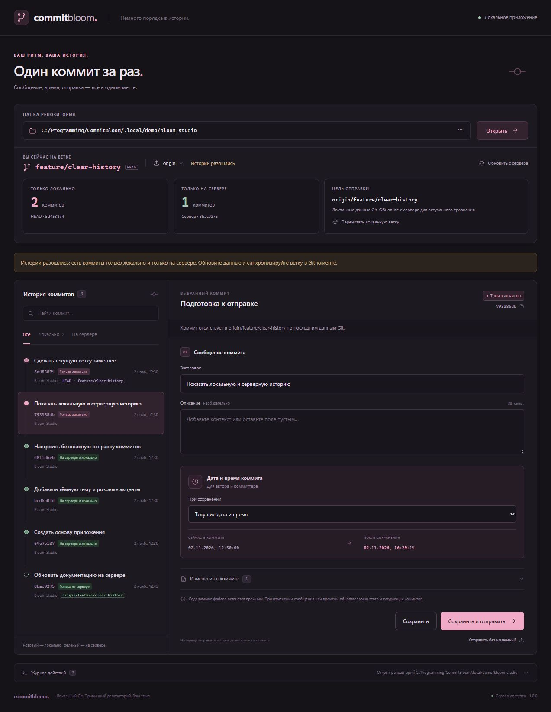

<div align="center">


# Commit Bloom 🌸

**Немного порядка в истории. Один коммит за раз.**

Локальный интерфейс для сообщений, дат и поочерёдной отправки Git-коммитов.<br />
Всегда видно, на какой вы ветке и где находятся ваши коммиты.

[](https://github.com/mifoxti/CommitBloom/actions/workflows/tests.yml)


[Быстрый старт](#быстрый-старт) · [Где мои коммиты?](#где-мои-коммиты) · [Безопасность истории](#безопасность-истории)

</div>



<div align="center"><sub>Настоящий интерфейс на демонстрационном репозитории. Тёмная тема, розовые акценты и никаких внешних шрифтов.</sub></div>

## Что умеет

| | Возможность |
| --- | --- |
| 🌿 **Понятная ветка** | Заметное имя текущей ветки, метка HEAD, хэши локальной и серверной вершин, точная цель отправки. |
| ↕ **Прозрачная история** | Счётчики коммитов только локально и только на сервере; отдельные метки и фильтры в списке. |
| ✏️ **Сообщения и даты** | Заголовок, описание, текущее или выбранное вручную время с часовым поясом. |
| 🚀 **Отправка по одному** | Предпросмотр операции, отправка с изменениями или без них. |
| 🛟 **Резервные ссылки** | Копия истории перед переписыванием, подтверждение опубликованных изменений и `force-with-lease`. |

Никаких npm-зависимостей, сборки, аккаунта приложения или облачного хранения. Используются уже установленные Git и Node.js.

## Быстрый старт

Нужны **Node.js 22.12+** и **Git** в `PATH`.

```sh
git clone https://github.com/mifoxti/CommitBloom.git
cd CommitBloom
npm start
```

Откроется [127.0.0.1:4313](http://127.0.0.1:4313). `npm install` не требуется.

**Windows:** можно просто дважды нажать `Start.cmd`. Не закрывайте окно запуска, пока работаете. `Ctrl+C` останавливает сервер. В Windows доступен системный выбор папки; на других ОС введите полный путь вручную.

Чтобы сразу открыть свой проект или выбрать другой порт:

```sh
node server.mjs --open --repo "C:/Projects/my-app" --port 4314
```

## Где мои коммиты?

Панель над историей отвечает на три вопроса: **где я**, **чего нет на сервере**, **чего нет у меня**.

| Метка | Что означает |
| --- | --- |
| **Только локально** · розовый | Коммит входит в локальную ветку, но отсутствует в выбранной серверной ветке по последним данным Git. |
| **На сервере и локально** · зелёный | Один и тот же коммит есть в обеих историях. |
| **Только на сервере** · зелёный контур | Коммит есть на серверной ветке, но не входит в локальную. Доступен просмотр сообщения и diff. Редактирование заблокировано. |
| **Локально · сервер не проверен** | Локальный коммит известен, но данных о серверной ветке пока нет. Нажмите «Обновить с сервера». |

При открытии используются **локальные сведения Git**. Нажмите **«Обновить с сервера»**, чтобы проверить ветку по адресу отправки; интерфейс покажет время проверки. Эти сведения — снимок состояния, сервер может измениться позже. Если ветка отсутствует, это будет указано явно.

Счётчики учитывают всю историю, включая боковые ветки слияний. Список показывает последние коммиты по первым родителям локальной ветки и отдельную историю, доступную только на сервере; при сокращении списка появляется пояснение.

При расхождении историй оба счётчика будут ненулевыми. Получите и синхронизируйте изменения в привычном Git-клиенте. Для переключения ветки тоже используйте Git-клиент, затем нажмите **«Перечитать локальную ветку»**. При возвращении в окно приложения локальная ветка перечитывается автоматически, если нет несохранённого черновика.

Отправка идёт в **одноимённую ветку выбранного remote**, указанную в «Цели отправки». Настройка upstream с другим именем ветки не меняет эту цель.

## Работа с коммитами

1. Откройте папку репозитория и выберите remote. Обновите данные с сервера.
2. Выберите локальный коммит. При необходимости измените заголовок и описание.
3. Выберите режим даты: текущая, вручную или исходная. Вручную доступны секунды и даты начиная с 1970 года; часовой пояс компьютера для выбранной даты показан под полем.
4. Нажмите «Сохранить», «Сохранить и отправить» или «Отправить без изменений» и проверьте предпросмотр.

При изменении времени обновляются даты автора и коммиттера; имя и почта автора сохраняются. Даты последующих коммитов сохраняются. В режиме текущего времени дата выставляется в момент сохранения, вручную выбранное время фиксировано.

**Git отправляет выбранный коммит вместе с его неопубликованными предками.** Для постепенной отправки выбирайте самый ранний локальный коммит, затем следующий:


Если сразу выбрать D, на сервер уйдут B, C и D. После изменения сообщения или даты хэши выбранного коммита и его потомков меняются; список обновляется автоматически.

## Безопасность истории

- Перед переписыванием создаётся резервная ссылка в `refs/commit-bloom/backups/`. Содержимое файлов коммитов, рабочие файлы и индекс сохраняются.
- Переписывание опубликованной истории требует отдельного подтверждения. `force-with-lease` проверяет конкретный ожидаемый хэш: если серверная ветка изменилась, отправка отклоняется.
- Опубликованные потомки сохраняются на сервере; случайного отката к более раннему коммиту не происходит.
- Связь старых и новых хэшей хранится в репозитории. Можно сохранить изменение локально и отправить позже; неизвестное расхождение утилита не перезапишет.
- Незавершённые Git-операции и подписанные коммиты блокируют переписывание: подписи нельзя сохранить после изменения хэша.

<details>
<summary><strong>Как посмотреть резервные ссылки и восстановить историю</strong></summary>

```sh
git for-each-ref refs/commit-bloom/backups/ --format="%(refname) %(objectname:short)"
git branch recovered-history refs/commit-bloom/backups/ИМЯ_КОПИИ
```

Если отправка не удалась после локального сохранения, изменения остаются локально. Интерфейс покажет ошибку и позволит повторить отправку. При таймауте сначала обновите сведения с сервера: он мог успеть принять коммит.

</details>

## Подключение и приватность

Приложение использует настройки Git, SSH и Git Credential Manager. Пароли и токены в интерфейсе не запрашиваются и не сохраняются. Если требуется вход, выполните его в терминале, затем повторите действие.

При отдельном `pushurl` проверяется адрес отправки. Несколько адресов отправки у одного remote не поддерживаются, чтобы исключить частичную публикацию на разных серверах.

HTTP-сервер слушает только `127.0.0.1`. Запросы защищены проверкой Host, Origin и случайным токеном сеанса. Интерфейс обращается к своему локальному серверу; Git соединяется с выбранным remote при обновлении и отправке. Путь последнего репозитория запоминается в локальном хранилище браузера.

## Разработка

```sh
npm test
```

Тесты создают временные репозитории и локальные bare-remotes. Пользовательские ветки и реальные серверы не изменяются. GitHub Actions запускает проверки на Windows и Linux.

```text
public/       интерфейс: HTML, CSS и JavaScript
lib/          Git-операции, выбор папки, завершение процессов
server.mjs    локальный HTTP-сервер и API
test/         интеграционные тесты Git и HTTP
docs/         логотип и скриншот интерфейса
```
